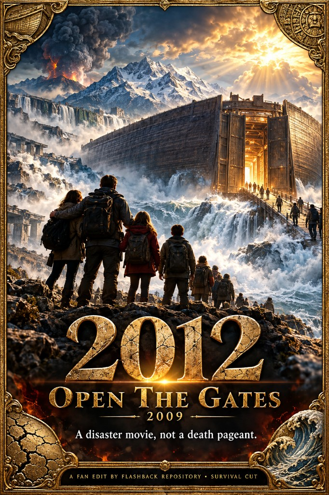

# 2012 (2009) — Open The Gates

A breath-of-fresh-air cut of Roland Emmerich’s disaster epic: the blended family actually gets along, unnecessary death spectacle is trimmed, and Russophobic “cheer the oligarch’s demise” beats are pulled so Gordon, Tamara, and Yuri stay characters in the story instead of sacrificial programming. Slogan: **A disaster movie, not a death pageant.**

## Motivation

Theatrical *2012* already has something rare for Hollywood disaster movies — Kate’s new husband Gordon, the kids, Jackson, and even Yuri’s circle spend most of the runtime cooperating instead of grinding through contrived family war. That goodwill is the film’s nicest brush. Then the script gears the audience to dislike Gordon (the “not the real dad” plastic surgeon) and kills him in the ark gears anyway, so viewers can cheer a death they were primed for. Same pattern with Tamara: the movie plays her warmly and innocently, then drowns her in the zoological bay — a leftover kill after the production stopped being mean to her for the whole runtime. Yuri’s boarding sacrifice repeats the beat for a Russian billionaire the film has already coded as imposing, ticket-buying, and self-oriented, even when individual scenes treat him kindly. Those deaths read as predictive programming more than story necessity: train the crowd to accept (or enjoy) the disposal of the step-parent, the girlfriend, and the oligarch.

Alongside that, the theatrical cut keeps interrupting the disaster with cover-up lore, assassination news digressions, information-control debates (“don’t warn the public yet”), and high-level desperation about tickets, gene pools, and who gets a relative on the boat. That talk fights the movie. This edit strips the cover-up and the cruelty so the catastrophe can lead.

**Open the gates:** after a boarding debacle nobody owns as a moral crime, the heads of state simply vote. There is no reason not to let the extra people without tickets aboard — so Helmsley’s sermon is unnecessary; the vote is enough.

This cut keeps the spectacle and the survival plot, but refuses the kill-switches. Gordon and Tamara live through to the boat with their personalities intact — ups, downs, and all — as people in the disaster, not props. Yuri’s sacrificial fall is out for the same reason. Family friction that undercuts the “everyone getting along” tone is trimmed where it isn’t required by the quake.

Sasha is a different problem: more standard Hollywood Russia-hate — the disposable Slavic pilot who dies “nobly” so the Western leads can keep moving (same energy as early *Star Trek* dressing Chekov in a woman’s wig for a gag). His Antonov cliff death is still in this cut because the Bentley glacier escape needs that beat; sparing him cleanly is a harder continuity problem than Gordon/Tamara/Yuri.

## Changes

- **Gordon survives** — removes the ark-gear crush (theatrical ~2:05: “Gordon, hold on…” / fatal gears) so the new husband is not killed for audience payoff.
- **Tamara survives** — removes her zoological-bay drowning and the “Mommy’s in there” / sealed-compartment aftermath (~2:10–2:14); she remains among the ark survivors with Caesar.
- **Yuri’s boarding sacrifice removed** — cuts the platform fall / “Papa!” twin hoist (~2:07) so the Russian billionaire is not martyred as Russophobic spectacle; his earlier abandonment of Tamara (affair beat) may still play as character, not as a prelude to a noble death.
- Trims family / ex-husband friction that fights the film’s cooperative tone (e.g. Lilly “What family?” phone spat; supermarket jealousy / crude “handle their boobs” beat; mid-flight “Do you love him?” / “Why do you hate Gordon?” talks).
- **Cover-up / info-control out** — Paris-tunnel / Louvre / Diana assassination-news digression; Laura “organization is a sham”; Anheuser “extra ticket / mother in wheelchair”; “nutbags… warnings… anarchy” debate; VP / Speaker succession grab; AF1 “I contributed to this cover-up” / art-soul lecture; “top-secret / monitor everybody” secrecy talk; geneticists / “we sold tickets”; “this is not a conspiracy, Helmsley.”
- **Cruelty / desperate ticket politics out** — roadside “send them back” / begging-for-children beats and other high-level relative-on-the-boat desperation that gets in the way of the disaster.
- **Open the gates without a sermon** — Helmsley’s long “to be human” speech removed; after the boarding debacle, a multinational vote is enough — no reason not to let extras without tickets aboard.
- Condenses the jammed-gate / flood / underwater-hydraulics hero dive so the ark can seal without Gordon’s death, Tamara’s drowning, or a suicide swim for the jam.
- Keeps Sasha landing the Antonov and dying when the jet goes over the cliff (stock “Russian pilot sacrifice” Russophobia, left in for Bentley/glacier logistics — not the same kill-switch pattern as Gordon/Tamara/Yuri).
- Charlie Frost Mayan/map material stays (plot MacGuffin for Yellowstone → China), not as elite cover-up lore.

### TODO

- **Visual continuity pass** — after removing Gordon/Tamara/Yuri deaths, spot-check ark crowd/gear inserts so nobody still “dies” in the frame without dialogue.
- **Sasha lives?** — optional later pass: keep him off the cliff without breaking the Bentley escape (stock pilot-sacrifice Russophobia; harder than the ark kills).
- **Misc. sub‑30s trims** (G8 chant, Caltech/governor phone shards, Antonov abort radio, ferry-grandpa line, Laura/Adrian flirt beat, etc.): confirm all were pacing/tone only, or list any still intentional.

---

Want to contribute a cut or fix notes? See [Submit](/submit).
