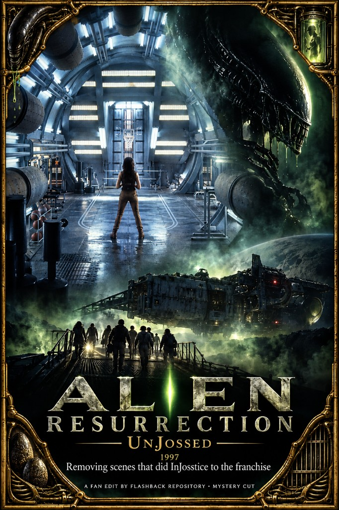

# Alien Resurrection (1997) — UnJossed

A leaner *Alien Resurrection* that cuts Whedon’s creep-and-quip fingerprints and the newborn rampage, so the genetic-crossover premise stays mysterious and the Betty crew can play as people — not as a joke writer’s mouthpieces. **UnJossed** (play on *unjust*). Slogan: **Removing scenes that did InJosstice to the franchise.** About **15 minutes** out of the theatrical cut.

## Motivation

The **genetic crossover** is fine. A **newborn** as a creepy new form of life is fine. What fails is what the theatrical climax does with it: the thing is born, immediately sprints a spaceship, boards the Betty, and attacks because it somehow “knows” Ripley is its mother and can track her. That tracking logic does not hold up. Removing the newborn on screen does not ruin the plot — it improves it. Something new was being created and was destroyed before it could be unleashed; you feel that without watching a run of puppeted slimy chase beats. Mystery over spectacle.

**What “UnJossed” means — and what it does not.** Joss Whedon’s credit here is mostly the **general premise**: a ragtag crew on odd jobs that gets pulled into a larger government/military plot. That template was already alive in Japanese work — *Cowboy Bebop* is the clear precursor — and then it traces back to Whedon in America (*Firefly* / *Serenity* is the same shape again). Associating him with that *shape* of story is fair. Associating him with every line of Betty-crew personality is not. The cast and the people who actually cared about making a film bring those characters to life; they rarely get the credit. The same credit imbalance showed up later when Whedon was treated as the face of the Avengers project, then left, and other filmmakers delivered some of the franchise’s best work before those too were taken away. The point is not “Whedon wrote nothing.” The point is he has a particular influence and should not receive credit for everything — **UnJossed**, as in *unjust*.

Concrete fingerprint of that influence in this film: inappropriate, out-of-character creep (e.g. the Betty pilot’s random sexual lines toward his co-pilot). That does not sound like who that character is. Those go. Other rough edges and crew color — basketball, Johner noise, surviving as a unit — read as the ensemble’s movie, not as Whedon-isms to purge.

### Citation: why the name leans on “unjust”

The unproduced **Wonder Woman** screenplay (draft dated **7 August 2006**) that later leaked online is a useful public sample of how Whedon wrote women’s bodies when unchecked — the text that heavily damaged his “progressive feminist” reputation. From that script:

> She’s curves and impossible strength. She’s gorgeous, but she doesn’t look like a supermodel. She’s built like a brick shithouse. Curvy, powerful, beautiful. She doesn’t have the elegant line of a dancer. She has the thick, heavy lines of a woman who was carved out of clay. She’s fierce. She’s naked. She’s vulnerable. She’s a goddess.

> Then she moves her leg back and turns, fluidly, a curve rippling up her body as she folds into a dance that is sensual, ethereal and wicked sexy.

Full draft (Indie Ground Films PDF): [Wonder Woman — Joss Whedon, 7 Aug 2006](https://indiegroundfilms.wordpress.com/wp-content/uploads/2014/01/wonder-woman-aug7-07-joss-whedon.pdf). Context: [ScreenRant on the leak](https://screenrant.com/joss-whedon-wonder-woman-movie-script/).

That is the voice this edit is refusing to let own the whole of *Alien Resurrection*.

## Changes

- **Newborn rampage / kill-show out** — no birth-to-Betty chase, no “it thinks you’re its mother,” no hull-vent evisceration (~theatrical 1:33–1:39). The crossover and the implication that something new was made and lost stay; the puppet spectacle does not.
- **Underwater xenomorph swim out** — flooded-corridor chase cut.
- **Creep / inappropriate Whedon lines out** — e.g. Elgyn’s “while your mouth’s warm” and related Betty/Auriga snark that reads as writer-creep, not character.
- Shortens outbreak / lifeboat padding and nest-approach chatter that only bridge into the newborn sequence.
- Betty launch and Earth coda remain.

### Still in the cut (intentionally)

- Failed **Ripley 1–7 clone lab — full sequence kept**, including the fire / incineration beat (clone-7 “Kill me” → burn → Johner “Fuckin’ waste of ammo” / “Must be a chick thing”). Validated edit SRT ↔ theatrical: same beats, uninterrupted. Gross but story-critical; left intact for now (tedium/grossness can be revisited later without treating it as a Whedon gag cut).
- Gediman’s **womb / “giving birth for you”** narration — **confirmed keep-as-mystery**: cryptic lead-in that something new was created and lost, without the newborn rampage on screen.
- **Betty crew color** (basketball, knife gags, Johner, etc.) — treated as ensemble personality, not automatic Whedon cuts.

### TODO

- **Clone lab** — optional later pass only if sitting through the burn still feels too tedious; **not** on the cut list now (confirmed kept).
- **~0:35 Call / Ripley ID** and **~0:37 “Don’t ever touch me”** — confirm intentional vs. accidental blanks.
- **Misc. sub‑30s** (cargo beeps, laugh beats) — pacing only?
- **Visual continuity** — after skipping the newborn aboard the Betty, spot-check airlock / blood / cocoon inserts.

---

Want to contribute a cut or fix notes? See [Submit](/submit).
