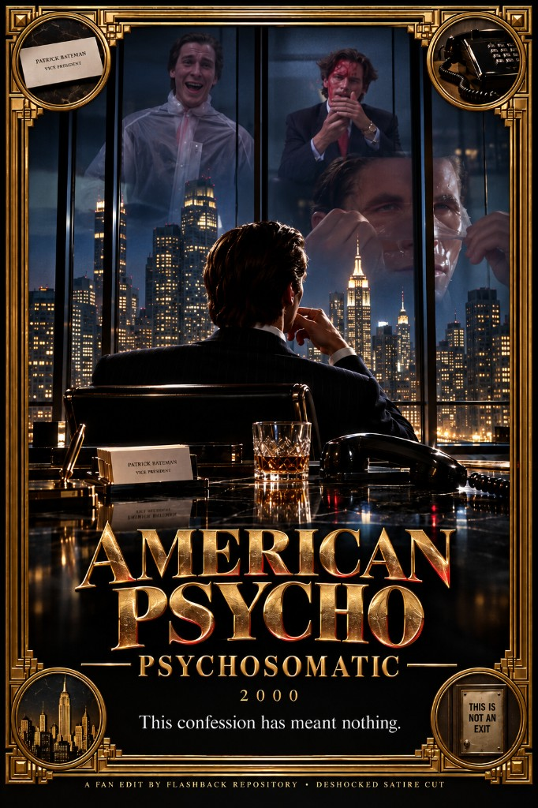

# American Psycho (2000) — Psychosomatic

*American Psycho* is a brilliant movie — unlike the original *Psycho*, or *The Texas Chain Saw Massacre*, or the other classic horror titles people stack it next to. This one stands out. Slogan: **This confession has meant nothing.**

Odd casting footnote: Christian Bale is a great Bateman — and it’s weird that he played a character named **Bateman** years before being cast as **Batman**. The name itself is widely read as an echo of [Norman Bates](https://time.com/archive/6740913/cinema-a-yuppies-killer-instinct/) from Hitchcock’s *Psycho* (Bates → Bateman). That Bateman→Batman jump occurred to me before I looked it up; online, fans [noticed immediately](https://whatculture.com/film/10-incredible-casting-coincidences-you-wont-believe?page=3) when he was cast in 2003, [Bale called it a “comical link”](https://whatculture.com/film/10-incredible-casting-coincidences-you-wont-believe?page=3) (both “American Psychos” in a sense), and [The Guardian](https://www.theguardian.com/film/2003/sep/12/news) even suggested *American Psycho* helped sell Warner on him. Most treat it as coincidence / wordplay — not a career pipeline — but the rhyme still feels too neat.

## Motivation

The only real problem is the same problem those other films have: a bunch of **excessive violence**, agenda-driven — Hollywood getting audiences ready for mass violence in real life. Making a movie like this *without* the horror scenes wasn’t possible at the time. It was expected. Underneath that packaging, though, is a very serious attempt to tell a creepy story about how things really work at the highest levels of our society — especially in New York.

The big controversy of this movie — [still argued](https://collider.com/american-psycho-ending-explained/) online — is whether all of the events happened in his head or not. The **“Feed me a stray cat”** ATM beat implies that the entire movie was fake; even [Harron points to that beat](https://www.moviemaker.com/american-psycho-ending-explained-by-writers-mary-harron-guinevere-turner/) as where realism slips. That *total*-fake reading is wrong. Just because Bateman is having delusions, and is a sick person, does not mean everything happening around him isn’t real. Harron and Turner [deliberately rejected](https://www.moviemaker.com/american-psycho-ending-explained-by-writers-mary-harron-guinevere-turner/) an “all a dream” ending ([Harron later called it a failure](https://www.denofgeek.com/movies/american-psycho-ending-misunderstood/) that too many viewers walked out thinking that), and [Turner has said](https://thedissolve.com/features/movie-of-the-week/515-the-reality-of-american-psycho-isnt-as-compelling-/) the killings are meant to be real under his skewed perception.

The most important part is that **he really committed the murder** — of one of his coworkers — and that it was **really covered up**. By everybody. The company. His dad. The people who work with him. The family of his victim. And Detective Kimball. Writeups that land near this usually stress [indifference and mistaken identity](https://www.looper.com/80476/ending-american-psycho-explained/) among Pierce & Pierce men, an apartment scrubbed for profit, and a world [too wrapped up in itself to care](https://collider.com/american-psycho-ending-explained/) — not pure fantasy.

Kimball stayed sharp on the case. He basically nailed it right away, saw all of the flaws and giveaways, and at the end of the movie tells Bateman straight up: it’s pretty much unthinkable that someone would murder his friend for absolutely no reason — isn’t that right? That is definitive evidence Kimball was 100% on top of him and his murders, laughing at the fact that the whole thing had been wrapped up and it was all over — and yet he was sitting right there looking at the actual murderer, who was still sweating and doing a terrible job talking his way out of it.

And just like the protagonist says at the end — his confession to himself, to his lawyer, and even his giveaways to Kimball have all meant **absolutely nothing**. Society will continue to chug along and protect all of its interests and the illusion that everything is sound and on the level. They will even allow him to continue murdering people, just as long as that is the path of least resistance for the entire society — the [satire of surfaces](https://lithub.com/on-the-decision-to-make-patrick-bateman-a-serial-killer) Ellis aimed at Reagan-era New York, where the confession evaporates into business as usual.

This cut strips the **shock sex** and **on-screen murder spectacle** Hollywood required as cover, so that spine can land: implication, cover-up, and the yuppie nightmare — not a snuff reel. The ATM-cat / witness-kill beat is out specifically because it oversells the “none of it happened” reading Harron never wanted; the Allen murder and Kimball’s investigation stay.

Labels below are from **Remaster SRT × current `playlist4` holes**. Do **not** trust `*.kdenlive.srt` for scene names — it skips the homeless-murder dialogue and drifts after ~00:20.

## Changes

- **Homeless Al murder** out (~00:20–00:22) — after business-card sweat; resumes at the **spa skin** beat (“beautiful skin”).
- **Extended Allen axe-striking** trimmed (~00:28, ~7s) as excessive violence; surrounding Huey monologue stays (the murder itself remains in the story).
- **Workout + chainsaw-movie screaming** after first Kimball (~00:37, ~21s) — excessive tension out.
- **Prostitute arrival / sex / murder** out (~00:39–00:46) — limo agreement straight to the lobby/bar “girl personalities” beat; all nudity, crude language, sex, and violence in that stretch gone.
- **Christie/Elizabeth sex + murder** out (~01:13–01:16) — after Whitney / flirting, straight to next-day dinner with Evelyn (murder reenactment drawn at the table).
- **“Feed me a stray cat” + witness murder** out (~01:18–01:19) — keeps a dream-like police chase without the on-the-nose ATM fantasy that invites the “whole movie is fake” reading; guilt is already hanging over him.

Full list: [CHANGES.md](CHANGES.md).

### TODO

- Point Kdenlive subs at `subs/American.Psycho.2000.Remastered.1080p.srt` if not already.
- Spa skin / Christmas still in cut — trim further only if picture still fights intent.

---

Want to contribute a cut or fix notes? See [Submit](/submit).
