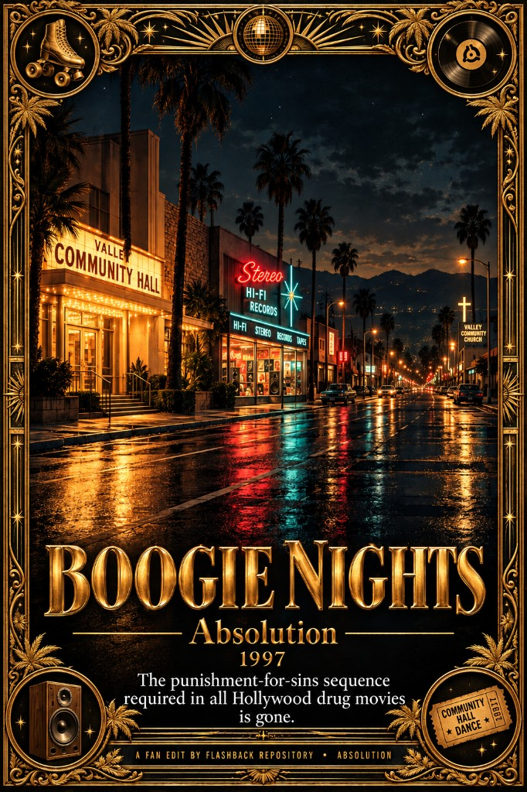

# Boogie Nights (1997) — Absolution

A single-block cut of PTA’s *Boogie Nights*. It removes the late punishment sequence, from the whip-pan out of Reed’s demo-tape office through Amber’s collapse and custody hearing, Dirk’s bank rejection, On the Lookout, the Valley night drive, and the donut-shop stick-up. Picture resumes on the film’s own fade into the Rahad-planning scene.

## What the movie is about

*Boogie Nights* presents the decay of American culture. The porn industry is the room where that decay is visible. The culture converts, more than once, inside these years:

- A community-hall, square-dance culture in the fifties
- A hippie culture in the sixties
- Extreme conformity in the seventies
- A religious reset in the eighties

Through all of that, people who had found freedom and a family were put at risk. What one decade treated as acceptable became unacceptable, and then illegal, in the next. The film’s solid messages sit in that history: the turnover itself, the drug dealers, and porn stars paid badly because of that history.

The child abuse in the movie is a control lever. It is the linchpin on the financier, ready to be pulled if he ever goes against the plan.

## What this cut removes

Those messages get ruined by the counter-message the film is forced to deliver toward the end. The rule is simple. Anyone who took part has to be punished, in the same movie, for their sins. Indulge in pornography or drugs and you lose your family, lose your children, get beaten, get rejected. The cultural change was real. The mandatory ending is something else.

Hollywood is not allowed to leave a movie like this without a punishment-for-your-sins sequence. That sequence is an old Catholic doctrine in script form: humans are born in sin and must be redeemed through the church. Someone comes in, edits the script, and writes the punishment. That block is what this cut removes.

## Why the drug deal stays

The Rahad scene stays. It is desperation and loss of agency. Dirk, Reed, and Todd thought they were extremely powerful and popular, the face of the change. The only move left to them is to fall back on the vice. That deal would have stayed a desperate buy if Todd Parker had not tried to deceive the drug lord. The message of the scene is the collapse, and it sets up the redemption sequence in the next scene.

## What changed

- Removes the stretch from Reed’s demo-tape office through Amber and Dirk, the bank loan, the custody hearing, On the Lookout, the Valley night drive, and the donut-shop stick-up
- Keeps Little Bill’s New Year’s suicide
- Keeps the Rahad drug deal: collapse into desperation, then the redemption that follows
- Resumes on the film’s own black hold into the Rahad planning scene

---

Want to contribute a cut? See [Submit](/submit).
