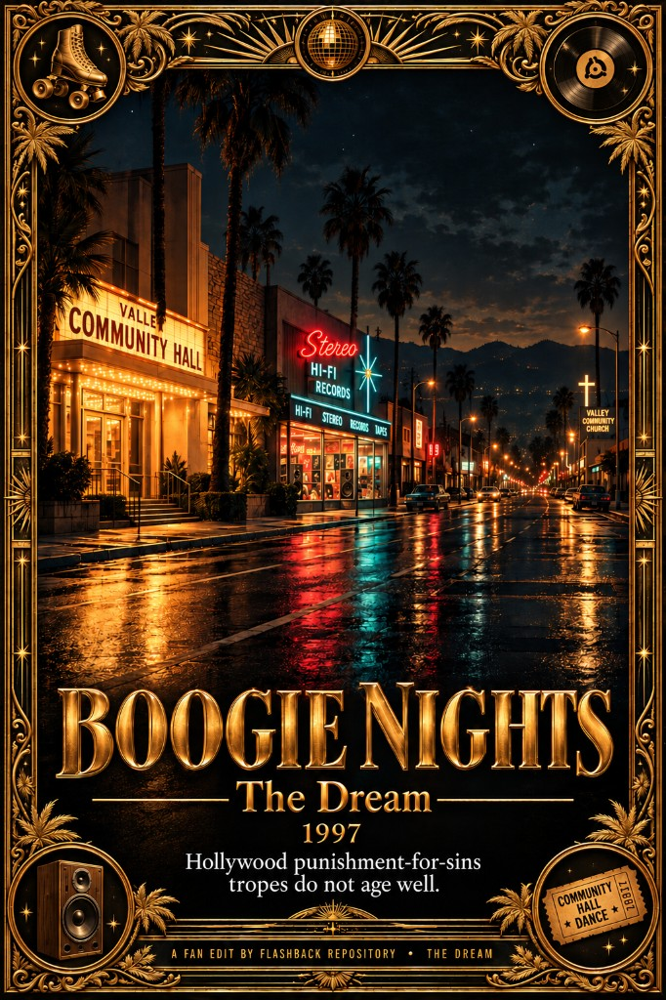

# Boogie Nights (1997) — The Dream

Slogan: **Hollywood punishment-for-sins tropes do not age well**

A cut of **Paul Thomas Anderson**’s *Boogie Nights*. It removes the late punishment sequence, from the whip-pan out of Reed’s demo-tape office through Amber’s collapse and custody hearing, Dirk’s bank rejection, On the Lookout, the Valley night drive, and the donut-shop stick-up. Picture resumes on the film’s own fade into the Rahad-planning scene. It also removes the Colonel’s jail beating, later, after Buck’s commercial.

**Not the same Paul as *Event Horizon*.** That 1997 film is **Paul W.S. Anderson** (then often credited without the initials). Both movies hit the same year under a near-identical billing. That name-fog is a Hollywood control habit: leave the public confused, merge the careers in memory, and the through-line between a portal disclosure and a Valley culture film never sticks. W.S. later took the middle initials so guilds and posters would stop conflating him with PTA — after the blur had already done its job. Shared producer on both: **Lloyd Levin**. We spell this out so we are not left out again. See [Event Horizon 1997](../Event%20Horizon%201997/).

## What the movie is about

*Boogie Nights* presents the decay of American culture. The porn industry is the room where that decay is visible. The culture converts, more than once, inside these years:

- A community-hall, square-dance culture in the fifties
- A hippie culture in the sixties
- Extreme conformity in the seventies
- A religious reset in the eighties

Through all of that, people who had found freedom and a family were put at risk. What one decade treated as acceptable became unacceptable, and then illegal, in the next. The film’s solid messages sit in that history: the turnover itself, the drug dealers, and porn stars paid badly because of that history.

The child abuse in the movie is a control lever. It is the linchpin on the financier, ready to be pulled if he ever goes against the plan.

## What this cut removes

Those messages get ruined by the counter-message the film is forced to deliver toward the end. The rule is simple. Anyone who took part in drug or sex culture has to be punished, in the same movie, for their 'sins'. Indulge in pornography or drugs and you lose your family, lose your children, get beaten, get rejected. Even Blow (2001) was forced to have that punishing ending. What is not allowed is an honest analysis of the justice system as it exists. That was reserved for other movies to tackle - like Find Me Guilty (2006).

Hollywood is not allowed to leave a movie like this without a punishment-for-your-sins sequence. That sequence is an old Catholic doctrine in script form: humans are born in sin and must be redeemed through the church. Someone comes in, edits the script, and writes the punishment. That block is what this cut removes.

The additional cut is the Colonel beaten in jail. The movie never explains the scene. It leaves completely open whether he had ever abused a child. What the scene is actually showing is a cultural change. The rest of the family abandons him. They cannot give themselves up to protect him from that change. It has the same shape as Little Bill’s suicide: something outside their control. To protect the family, they put their attention on the people who are actually in need, and the Colonel is left behind.

That beating still comes out. Hollywood should not send an incomplete message like this. The Colonel is completely innocent. Even on the reading that he looked at pornography of children, a real police officer would have followed that to the people making it. Stopping at one person using it leaves a contradiction the film never addresses.

A Beach Boys song plays across the whole jail scene. Lifting the scene breaks the song, and the join is obvious. The scene still goes.

## Why the drug deal stays

The Rahad scene stays. It is desperation and loss of agency. Dirk, Reed, and Todd thought they were extremely powerful and popular, the face of the change. The only move left to them is to fall back on the vice. That deal would have stayed a desperate buy if Todd Parker had not tried to deceive the drug lord. The message of the scene is the collapse, and it sets up the redemption sequence in the next scene.

## What changed

- Removes the stretch from Reed’s demo-tape office through Amber and Dirk, the bank loan, the custody hearing, On the Lookout, the Valley night drive, and the donut-shop stick-up
- Removes the Colonel’s jail beating after Buck’s commercial. Buck’s “that was great” stays. Picture returns as the next scene is already underway
- Keeps Little Bill’s New Year’s suicide
- Keeps the Rahad drug deal: collapse into desperation, then the redemption that follows
- Resumes on the film’s own black hold into the Rahad planning scene

---

Want to contribute a cut? See [Submit](/submit).
