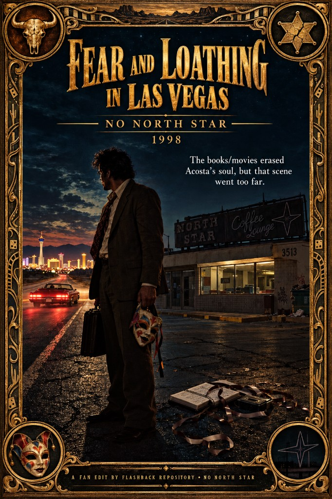

# Fear and Loathing in Las Vegas (1998) — No North Star

The books/movies erased Acosta’s soul, but that scene went too far.

## Motivation

Oscar Zeta Acosta was not Dr. Gonzo. He was a Chicano lawyer who wrote himself as the **Brown Buffalo** — quitting poverty-law respectability, walking into East L.A. politics, defending militants, running for sheriff on an anarchist platform, and living inside a real bombing climate (Chicano Liberation Front era). Read *The Autobiography of a Brown Buffalo* and *The Revolt of the Cockroach People*. That man is dangerous and political. A mass book that led with **both** his Chicano-rights counsel **and** his anarchist/bombing-orbit ambitions could go viral the wrong way. So the product does not tell that truth.

Hunter’s path of least resistance — and it may well be Hunter’s own typing, not a ghost — was to wring the Vegas trip dry for **comedy material**, cut ties with a radioactive associate, and leave out the soul of Acosta’s ambitions. Acosta told Alan Rinzler that Hunter had stolen his soul, taken his best lines, and wrung him dry for material. The load-bearing part is the third: material harvested into Hunter’s byline. “Soul” here reads as the ambitions and history that never lead the poster. “Best lines” is the softest claim. The settlement was photo and caption and Straight Arrow novels — not co-credit, not ethnicity restored, not the Brown Buffalo on the cover.

*Where the Buffalo Roam* (1980) is closer even under the false name Carl Lazlo: a lawyer who **quits**. Gilliam’s film keeps the Vegas lie: Samoan gag, appetite gag, knife-diner cruelty. Latino casting and Chicano posters in the L.A. office do not fix a script that still erases what he was.

Oscar Zeta Acosta disappeared mysteriously in May 1974 while traveling in Mazatlán, Mexico, and his body was never found. Thompson’s “Banshee” is half requiem, half brand management over that void.

### Working conclusions

These are the working conclusions from the investigation — not a closed murder case:

- **Samoan freeze = deliberate demotion.** Keep Chicano counsel and anarchist/bombing-orbit truth off the mass stage. You cannot safely “call him out” as bomber in a youth hit — that backfires into martyr copycats. So you make him carnival.
- **Hunter’s useful role = harvest + contain.** Comedy material under an Anglo byline; radioactive associate cut down to size. Acosta himself called Hunter the **“Benedict Arnold of the cockroach revolt”** for helping halt the bombings. That outcome is a stability win whether or not anyone’s paycheck said intel.
- **Early NSA-functional alignment (open on payroll, closed on function).** Gonzo as ground-truth reporting that still prefers reality and domestic stability over CIA-style martyr theater. Eyes on the prize; demotion beats assassination copy. Institutional membership unproven.
- **Mazatlán: rule “drug deal gone bad” down.** Trafficking networks are family-oriented; a temporary loud cog is rarely worth a clean disappearance unless he threatened the network. The rumor also demotes him the same way Samoan did — appetites, not revolt.
- **Stronger threat profile = armed revolutionary export + domestic firebomb orbit.** Acosta’s own autobiographical essay (~1971): he was on his way to **Guatemala to smuggle guns to the revolutionaries and write about them**, **stopped in Juárez**, jailed, then redirected to L.A. walkouts. **Intent is primary-sourced; successful overseas guerrilla founding is not.** *Buffalo Roam* amplifies Lazlo into on-screen Latin-American gun-running under a fake name — film threat story, not documentary proof. Domestic *Cockroach* climate (Molotovs, Tooner Flats firebomb charges, CLF banners) already made him radioactive at home. If even the beginnings of cross-border gun logistics were real, foreign or partnered security actors have a coherent motive to erase him — the same motive class as suppressing his terrorism-adjacent orbit in California.
- **“Italian-style fascism” as his program is not in the primary texts.** Anarchist sheriff / Chicano revolt / firebomb-orbit counsel. Say revolutionary force if that is the claim; do not glue Mussolini onto Acosta without a cite.

Full triage: [Hunter Thompson — authorship prop, Acosta, Nixon](/home/ari/dev/pt/paradigm-threat-files/influence/stolen_credit/investigations/hunter-thompson-authorship-prop-nixon-investigation.md) §§7–9.

### Who suppressed him?

The Samoan label is deliberate demotion. Motive is not only comic color. It is to keep two contagious truths off the mass stage: Chicano civil-rights counsel, and anarchist revolt (including the bombing climate Acosta wrote himself inside and later called Hunter a Benedict Arnold for helping to halt). You cannot safely “call him out” as bomber in a youth hit — that backfires into martyr copycats. So you do not call him out. You make him carnival.

Big players had a stake: Rolling Stone / Straight Arrow, Random House counsel, California legal and police establishments, later the film machine. Hunter is the cover name and the least-resistance typist. Protection talk in “The Banshee Screams for Buffalo Meat” (Samoan to shield him from L.A. cops) sells erasure as care. Freezing Acosta’s own Samoan joke from *Brown Buffalo* into his only public face is the same demotion.

The film keeps one deliberate wink at the firebomb history and sells it as gag. After they get thrown out of Debbie Reynolds at the Desert Inn — *Sgt. Pepper* in a silver Afro wig — Gonzo snarls that he’ll burn the man’s house down, then: **“One of these days I’ll toss a fucking bomb in that place.”** That is not random gonzo noise. It is Acosta’s bombing-orbit past (CLF-era firebombs; *Cockroach People*’s Safeway cocktails and Hall of Justice talk) laundered into a punchline about a lounge Beatles show. The mass product will not name the revolt. It will let the attorney joke about bombing Debbie Reynolds.

### Why this cut — North Star

The books/movies erased Acosta’s soul, but that scene went too far.

Terry Gilliam did **not** keep North Star by accident. He treated the Coffee Lounge as the moral nadir and structural anchor of the whole film — “two guys who have gone beyond the pale… unforgivable” — and has repeatedly called it his favorite and most important scene: the beat where Gonzo crosses into real threat with the phone and the knife, Duke has to make a moral choice, and the movie stops being a pure drug romp. Earlier scripts often dropped it; Gilliam put it back on purpose.

There is also a verified factual basis for Acosta being volatile and aggressive with people in real life. Thompson’s own packaging leans on that danger. Specific cinematic beats like the knife-wielding waitress terror may be dramatized for the screen — but the mean streak is not invented from nothing.

**Still: without being honest about who Acosta is, that scene cannot stay.** On a Samoan carnival sidekick with ambitions cut out, North Star does not reveal a dangerous political man. It **steals his soul** again — violence without the Brown Buffalo, without Chicano counsel, without the firebomb-orbit stakes that made him radioactive. Honesty about a violent man would lead with that history. This cut refuses to screen the cruelty as the price of admission to a dishonest Acosta, even if he was known for being violent.

The preceding narration already names the crime (“a really massive crime often slips by unrecognized”). Skipping the diner leaves the reflection intact and resumes on the Red Shark run to the airport.

## The 1998 film machine

How the Vegas product got locked into carnival chaos instead of a harder political read:

- **John Cusack.** Cusack directed a successful stage version of the book and was Thompson’s close friend. He was nearly locked to play Duke until Thompson met Johnny Depp, instantly finding a “kindred spirit” he insisted must play him.
- **The director shuffle.** Original director Alex Cox was fired after fierce creative differences with Hunter S. Thompson over the script (producer Laila Nabulsi forced the studio choice; Thompson’s disapproval of the Cox/Davies treatment is on record in *Breakfast with Hunter*). Cox wanted a serious, structured anti-war film with heavy animation; Thompson and Depp demanded a wildly chaotic, literal interpretation of the book. Terry Gilliam stepped in and, with Tony Grisoni, rewrote the screenplay from the book in about ten days (Gilliam: eight days then a two-day rewrite).
- **The Writers Guild war.** The WGA initially refused to give Gilliam and Grisoni screenwriting credit, attempting to credit only Alex Cox and Tod Davies even though the production had discarded that script. Gilliam publicly went to war with the union — including resigning / burning his WGA card in protest — before the credits were amended to list Gilliam and Grisoni first, then Cox and Davies.
- **Box office disappointment.** Commercial flop on release: about **$10.6 million** against an **$18.5 million** budget, heavily polarizing critics, before evolving into an iconic cult classic. The novel reprints spiked anyway.

Net effect of the shuffle: the version that survived is the one Thompson and Depp wanted — literal carnival chaos — not Cox’s heavier anti-war/animation frame. The Samoan sidekick machine stayed intact either way. North Star stayed in because Gilliam chose it as his favorite scene and the film’s moral bottom — which is exactly why this cut has to answer him: nadir on a fake Acosta is still soul-theft.

## Changes

- Removes the North Star Coffee Lounge scene
- Keeps Duke’s “massive crime often slips by unrecognized” line; next line is “It was all over now.”
- Full list: [CHANGES.md](CHANGES.md)
- Subs: default **English** is dialogue; **English (citations)** / Enhanced cites Acosta’s real history in silence gaps (Samoan demotion, CLF/firebombs, Debbie bomb wink, lawsuit/settlement, Chicano counsel, Mazatlán). Rebuild: `python3 build_citations_srt.py`

## Reading

Acosta first, then the machine that packaged him:

- Oscar Zeta Acosta — *The Autobiography of a Brown Buffalo* (1972)
- Oscar Zeta Acosta — *The Revolt of the Cockroach People* (1973)
- Oscar Zeta Acosta — *The Uncollected Works* (ed. Stavans) — letter to Hunter; Playboy gonzo letter; autobiographical essay (Guatemala guns / Juárez)
- Hunter S. Thompson — “The Banshee Screams for Buffalo Meat” (in *The Great Shark Hunt*)
- [What “Fear and Loathing in Las Vegas” Owes to Oscar Acosta](https://www.newyorker.com/books/second-read/what-fear-and-loathing-in-las-vegas-owes-to-oscar-acosta)
- Working notes: `~/dev/wget/acosta/ANALYSIS.md`
- Investigation: [Hunter Thompson — authorship prop, Acosta, Nixon](/home/ari/dev/pt/paradigm-threat-files/influence/stolen_credit/investigations/hunter-thompson-authorship-prop-nixon-investigation.md) — Mazatlán data (§7), drug-deal vs guerrilla-export triage (§8), Hunter as early NSA-functional containment (§9)

---

Want to contribute a cut or fix notes? See [Submit](/submit).
