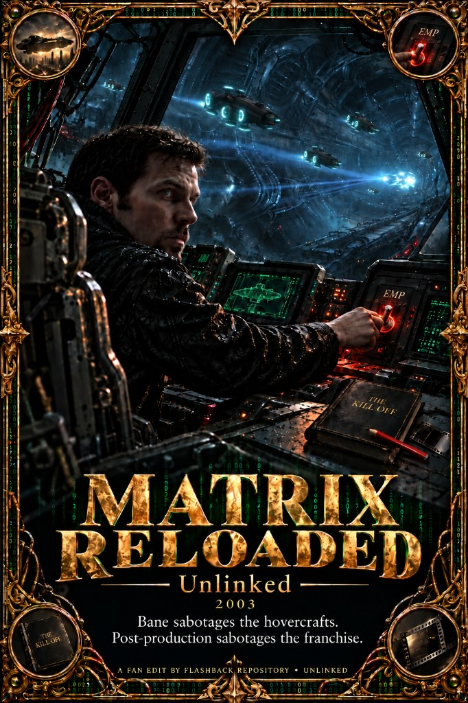

# Matrix Reloaded (2003) — Unlinked

Bane sabotages the hovercrafts. Post-production sabotages the franchise.

*Reloaded* and *Revolutions* were entirely designed by the Square USA team after *Final Fantasy: The Spirits Within*. ESC did what Square could not: the highest-definition shaders then available, the best ray tracing and CPUs, and, most of all, live-action integration. That live action is why most people never see the connection. Watch both films and imagine *Revolutions* as 100% CGI, with no live action, and the scenes line up past a reasonable doubt — including the mass carnage, the same kind of mayhem scene in *The Spirits Within* and in *Revolutions*. The industry could not allow Square to become a competitive CGI house. They were shut down with no reason given. The work was suppressed under IP law, and the shops were shuttered and contained in Hawaii and in Japan.

*The Matrix* (1999) needs no edit. It was a cultural revolution, not a nerd-out movie: an NSA-aligned wake-up, told through people rather than a lecture. Morpheus says you are a slave. The Oracle carries the same grammar. The end credits roll Rage Against the Machine’s “Wake Up,”. *Reloaded* looks sabotaged in post. The inserts lift cleanly, and the scene around them still paces, which is why they read as post-production decisions rather than scenes the picture was built on. *Revolutions* is the other damaged project. *Resurrections* undoes the M1/M2 message and is not watched here, the same fall as *Thor: Love and Thunder* and the other franchises that had a brief high-quality alignment and then dropped back to the Hollywood default. Even the techno music in Reloaded was bad. Don David's work was excellent regardless.

## Motivation

The notorious post production sabotage is the orgasm brownie scene. It is the beat that makes many people not want to sit through the movie again. The other cost of that post pass is the Merovingian: left extra long and ranty, so people were already exhausted by the time the Architect started talking. This cut shortens that rant — the wine, the cake, and Persephone’s “It’s just a kiss.” Zee is a separate removal. What comes out clean is the Merovingian scene’s pacing. It does not slow down before the big fights. It ramps straight into them. That ramp is the original intent. Post-production slowed the scene with extra ranting and CGI. Persephone’s affair stays in the plot because the Merovingian calls her out before the chateau scene. The Neo/Trinity “I need you” beat and the temple speech stay. Gloria Foster’s Oracle is still the M1-style voice in this film. She is gone by *Revolutions*.

The cast was the other sabotage, and it is most of why these two edits exist. Tank was popular. The sequels kill him off-screen and swap in Link, a stereotype next to him. Marcus Chong’s account is *The Kill Off*. Hollywood did not want a mixed character. It wanted the sorted types — Black, white, Mexican, the rainbow set. Link is that insert. Taking him back out is the point.

The picture that still works is that Square design. Warner parked the credited piece on the Animatrix short and put ESC on the features. Films two and three were sabotaged with that team: mostly in post, and in the live-action scenes, so an average viewer could list the cringe, the contradictions, and the padding and say the filmmakers simply were not good enough. They were. This cut is an attempt to make that original vision readable again. The *Revolutions* tributes — Neo on translucent water, the spiritual Sentinel impalement, the mass carnage — are on that film’s page.

The brownie button itself (“You first,” about 00:32:56 on the source) is still on this timeline. It sits between the temple speech and Hamann on the engineering level, in a stretch with no playlist gap.

## Changes

- Removes Link’s first scenes, the Zion greeting, Zee and the kids, and Zee’s charm.
- Removes Lock’s “removed from duty” line, the Niobe dance memory, and Link’s freeway call.
- Removes the Merovingian’s wine and cake speeches, and Persephone’s kiss.
- Full list: [CHANGES.md](CHANGES.md).

## Reading

- [Not Like This](https://paradigmthreat2.substack.com/p/not-like-this) — M1 as the NSA-camp wake-up, then the contain campaign: Square’s Sentinel and Zion design, no feature credit, the Aki Ross rhyme, and Sony unplugging *The Matrix Online* (“Not like this”).
- [Before Barney, Teletubbies, and Pokémon](https://paradigmthreat2.substack.com/p/before-barney-teletubbies-and-pokemon) — Square taken off Nintendo onto Sony’s machine, and the quality drop that followed.
- [Crichton’s Prophecy](https://paradigmthreat2.substack.com/p/crichtons-prophecy) — the Nintendo–Sony rupture in the same years, told as a product captain deleted by the office.
- [You are a slave, Neo](https://paradigmthreat2.substack.com/p/you-are-a-slave-neo) — the bondage line, and why the first film sits on the NSA side of that war.
- [Ghost War: The Antibody Phase](https://paradigmthreat2.substack.com/p/ghost-war-the-antibody-phase) — the NSA / antibody lane versus the CIA lane these films are sorted against.

---

Want to contribute a cut or fix notes? See [Submit](/submit).
