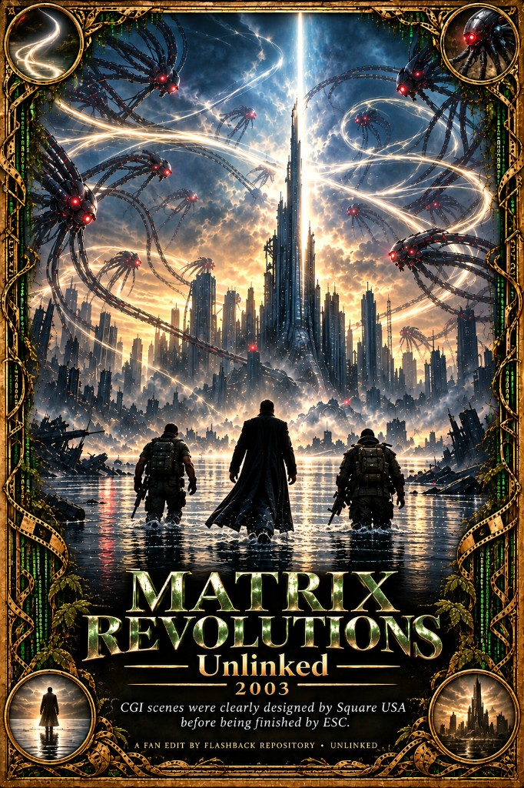

# Matrix Revolutions (2003) — Unlinked

CGI scenes were clearly designed by Square USA before being finished by ESC.

*Reloaded* and *Revolutions* were entirely designed by the Square USA team after *Final Fantasy: The Spirits Within*. ESC did what Square could not: the highest-definition shaders then available, the best ray tracing and CPUs, and, most of all, live-action integration. That live action is why most people never see the connection. Watch both films and imagine this one as 100% CGI, with no live action, and the scenes line up past a reasonable doubt. The mass carnage is the same kind of mayhem scene in both *The Spirits Within* and here. The industry could not allow Square to become a competitive CGI house. They were shut down with no reason given. The work was suppressed under IP law, and the project was contained in Hawaii and in Japan.

*The Matrix* (1999) needs no edit. It was a cultural revolution, not a nerd-out movie: an NSA-aligned wake-up, told through people rather than a lecture. Morpheus says you are a slave. The Oracle carries the same grammar. The end credits roll Rage Against the Machine’s “Wake Up,” including the lyric-sheet correction — “never read it,” not “never edit.” *Reloaded* and *Revolutions* were severely sabotaged. By this film Gloria Foster is gone and Mary Alice has the Oracle. *Resurrections* undoes the M1/M2 message and is not watched here, the same fall as *Thor: Love and Thunder* and the other franchises that had a brief high-quality alignment and then dropped back to the Hollywood default.

## Motivation

A short companion to [Reloaded — Unlinked](../Matrix%20Reloaded%20(2003)%20-%20Unlinked/). About three minutes of the source file are not on the timeline.

The shared reason for both edits is Link. Tank was popular in the first film. The sequels kill him off-screen and replace him with Link, a stereotype. Marcus Chong’s account is *The Kill Off*. Hollywood did not want a mixed character. It wanted the sorted types — Black, white, Mexican, the rainbow set. These cuts take Link back out.

What still looks like the original vision is that Square design, finished by ESC and then hidden under live action. Two shots read as direct tributes: Neo stepping on translucent water, the way Aki Ross stands on translucent ground, and a Sentinel impaling him where the wound is spiritual rather than a body hit — the same sequence as Aki. The mass carnage is the third. Side by side: [Spirits Within × Revolutions](https://youtu.be/WZNu_OVFXWQ). *The Matrix Online* was later shut down; the record of that unplugging is called *Not like this*, and Sony is the dubious hand on the plug. The project subtitle file is the cut clock, so the other gaps are not named yet.

## Changes

- Ten source ranges are skipped. The splices are listed in [CHANGES.md](CHANGES.md).
- Naming them needs a source-timed SRT.
- **English (citations)** — `subs/Matrix Revolutions (2003) - Unlinked.enhanced.srt`. The two *Spirits Within* cards stay: the impalement in the silence before “Gotcha,” and the translucent-water walk after Trinity dies. Smaller notes sit on the line they belong to: Mary Alice’s “I’m the Oracle,” “The end of the war,” the dock Sentinels, Link’s name, “Gotcha” itself, and the last “I believed.”

## Reading

- [Not Like This](https://paradigmthreat2.substack.com/p/not-like-this) — Square’s Sentinel and Zion design, the Aki Ross stab left in this film, no feature credit, Foster gone before the finale, and Sony unplugging *The Matrix Online*.
- [Before Barney, Teletubbies, and Pokémon](https://paradigmthreat2.substack.com/p/before-barney-teletubbies-and-pokemon) — Square taken off Nintendo onto Sony’s machine, and the quality drop that followed.
- [Crichton’s Prophecy](https://paradigmthreat2.substack.com/p/crichtons-prophecy) — the Nintendo–Sony rupture in the same years, told as a product captain deleted by the office.
- [You are a slave, Neo](https://paradigmthreat2.substack.com/p/you-are-a-slave-neo) — the bondage line, and why the first film sits on the NSA side of that war.
- [Ghost War: The Antibody Phase](https://paradigmthreat2.substack.com/p/ghost-war-the-antibody-phase) — the NSA / antibody lane versus the CIA lane these films are sorted against.

---

Want to contribute a cut or fix notes? See [Submit](/submit).
