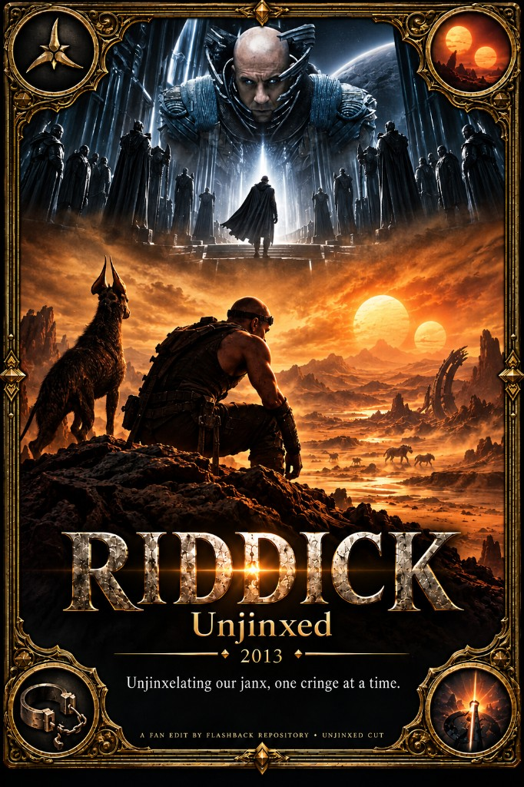

# Riddick (2013) — Unjinxed

A dialogue-trimmed *Riddick* that **Unjinxs** the merc chatter, kills the opening predator beat, and plays the Necromonger “wrong planet” flashback as a **linear prologue** so you know why he’s stranded before the desert hunt begins. Slogan: **Unjinxelating our Janx, one cringe at a time.** About **~20 minutes** of source picture out of the feature (plus disc extras dropped off the rip); edit runtime ~**1 h 47 m**.

## Motivation

Theatrical *Riddick* dumps you into desert survival and only later explains the Necromonger betrayal that left him on the wrong world. That mid-film flashback is good story — bad placement. This cut front-loads it so exposition is linear: wrong planet, Krone, stranded VO, **then** wounded Riddick and the mercs.

The other half of **Unjinxed** is tone. Merc teams talk themselves into failure — “you are jinxing our janx,” dick-measuring over nodes, Dahl sex jokes, Johns’s long Pitch Black interrogation that stalls the hunt. Those beats are the 2013 movie’s sleaze and stall. Cutting them keeps the survival thriller and the Necromonger frame without the self-jinx.

Companion to [The Chronicles Of Riddick (2004) — Fry's Edition](../The%20Chronicles%20Of%20Riddick%20(2004)%20-%20Fry's%20Edition/) — same franchise cleanup: less sleaze, clearer spine.

## Changes

- **Flashback prologue** — Necromonger / wrong-planet block (~source `10:54–22:51`, skipping Vaako) plays **before** desert survival. In-body flashback omitted from the main timeline (no mid-film repeat).
- **Vaako / Furya-bait conspiracy** (`~13:25–15:50`) stays **cut** — hard jump inside the prologue.
- **Opening vulture / pterosaur kill** removed; main desert story starts on the **“crossed off the list”** VO (`~00:01:13`).
- **Merc / Unjinxed dialogue trims** throughout — e.g. nodes-as-trap posturing and “jinxing our janx,” ship-node compatibility rant, Johns bounty / Pitch Black interrogation stretch, Dahl “kill him / fuck him” flank beat, assorted short sexist or exaggerated lines.
- **Savanna bridge** kept once after main survival; **Necromonger epilogue** (`~1:41+`, Vaako / Transcendence) remains at the **end**.
- Disc extras after the feature on this rip are out of the timeline.

### Still in the cut (intentionally)

- Jackal / desert survival spine after the prologue.
- Merc arrival, beacon, and the creature night — plot-necessary action kept.
- Necromonger capital-ship coda after the climax (not moved into the prologue).

### TODO

- **QC joins** — prologue → main dip-to-black; Vaako gap inside prologue; savanna bridge once-only.
- **Short silent holes** (sub‑30s / no-subtitle stretches) — confirm pacing vs. accident.

---

Want to contribute a cut or fix notes? See [Submit](/submit).
