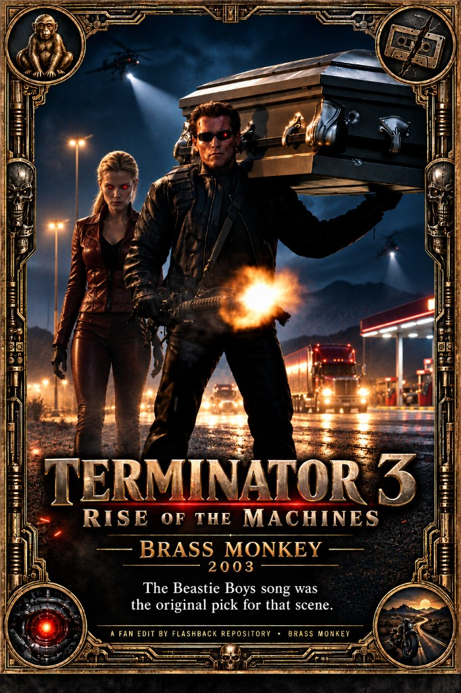

# Terminator 3 (2003) — Brass Monkey Edition

T3 tries to be T1/T2 and keeps stepping on itself — shticky open, exposition that sounds like the characters read the script, and John Connor written as a pouty obstacle. This cut trims that clutter so the chase and the machines can carry the movie. The name is not a joke title: it is the needle-drop the scene was always asking for. Slogan: **The Beastie Boys song was the original pick for that scene.**

## Motivation

This edit is also an **investigation**. The most incredible part — and the reason it’s called **Brass Monkey** — is not the cut list. After watching T3, the first time I heard Beastie Boys’ [“Brass Monkey,”](https://en.wikipedia.org/wiki/Brass_Monkey_(song)) I actually thought *that* was the song under the dead-radio / gas-station caretaker beat. When I put the movie back on to confirm, it wasn’t. It was [“Dat Funky Man”](https://www.imdb.com/title/tt0181852/soundtrack/) — [words by director Jonathan Mostow](https://www.terminatorfiles.com/media/articles/moviesfacts_007.htm), music by Peter Beckett, the cue fans have long [called out as a WTF needle-drop](https://whatculture.com/film/67-wtf-moments-from-the-terminator-franchise?page=18).

From that misfire I **deduced** that Brass Monkey was the original pick for the scene — even if we will never get a memo or interview admitting it out of the whitewashed intellectual property that manages this franchise. It is simply the only story that adds up.

What’s wilder is that I didn’t expect a Beastie Boys connection to this movie at all — and yet there is one, just for a **different** song ([“Sabotage”](https://en.wikipedia.org/wiki/Sabotage_(Beastie_Boys_song))). That smells like cover-up and misdirection: point the brand at the wrong Beastie Boys track so the one that actually fits the picture never lands. The artistic proof is blunt — [“Brass Monkey”](https://en.wikipedia.org/wiki/Brass_Monkey_(song)) matches the scene’s tone perfectly; [“Sabotage”](https://en.wikipedia.org/wiki/Sabotage_(Beastie_Boys_song)) does not match the final tone of that beat at all.

There are too many lineups for this to have been (A) completely overlooked, or (B) just a coincidence that Beastie Boys happen to have this far superior temp track that somehow wasn’t used. Only [“Brass Monkey”](https://en.wikipedia.org/wiki/Brass_Monkey_(song)) among the obvious candidates carries the word **funky** in the song itself — and the theatrical replacement is literally titled **Dat Funky Man**. That is not how random song swaps look. Do you agree?

The rest of the edit is the usual T3 cleanup. Bad comedy aging worse every year, Nick Stahl’s John talking the film to death, Kate’s wedding/relationship padding, and early gags (nude arrivals, Victoria’s Secret morph, strip-club Arnie) that play like studio notes. Mostow has even [admitted](https://www.theterminatorfans.com/terminator-3-director-admits-movies-humor-hasnt-aged-well/) the early humor hasn’t aged well. Keep the Terminator movie; throw out the stuff that makes you root *against* the humans. Other fan edits [cut the Dat Funky Man scene](https://whatculture.com/film/10-movie-scenes-that-fans-tried-to-34-fix-34?page=7) — this one keeps the picture and restores the deduced original needle-drop.

## Changes

**~15.1 min removed across 38 picture holes**, plus the Brass Monkey needle-drop (source **00:42:38–00:43:30**). Full list: [CHANGES.md](CHANGES.md).

### Open / T-X arrivals
- John’s **opening narration** and the lame future-T-1000 scare → wake → motorcycle handoff
- Short trims on the **nude T-X** “Are you okay?” beat, **Victoria’s Secret boob FX**, and **“I like your gun”** / cop-window take

### Tone & comedy
- Nude Schwarzenegger / **“talk to the hand” strip-club** block and the **Elton John–style glasses** gag
- **Junkies** line, **obnoxious cat-woman** clinic dialogue (programming that only makes you want her dead), **Mike Kripke’s basement** reminisce (and the later rematch)

### Plot / character clutter
- Early bridge: Kate + boyfriend **shopping**, military **Skynet spoiler**, Kate uncertainty + **dad call** — join on the virus brief
- Kate’s **“let me go if I tell you where John is”** bargain that the T-X then **lies** about
- Cringy machine-lecture beats (“You’ll find a way to destroy her” — did he read the script?), **anti-Terminator Terminator** gag, destiny / breeding-age / “she’s your wife” / spouse–second-in-command dumps, **“fuck my destiny”** gun-to-head, Sarah **leukemia/Baja** speech, Crystal Peak **“nothing here”** flop

### Music
- Dead-radio / caretaker stretch (around hole 23 through “talk to the hand”) — theatrical [“Dat Funky Man”](https://www.imdb.com/title/tt0181852/soundtrack/) → Beastie Boys’ [“Brass Monkey”](https://en.wikipedia.org/wiki/Brass_Monkey_(song))

## Trailer

---

Want to contribute a cut or fix notes? See [Submit](/submit).
