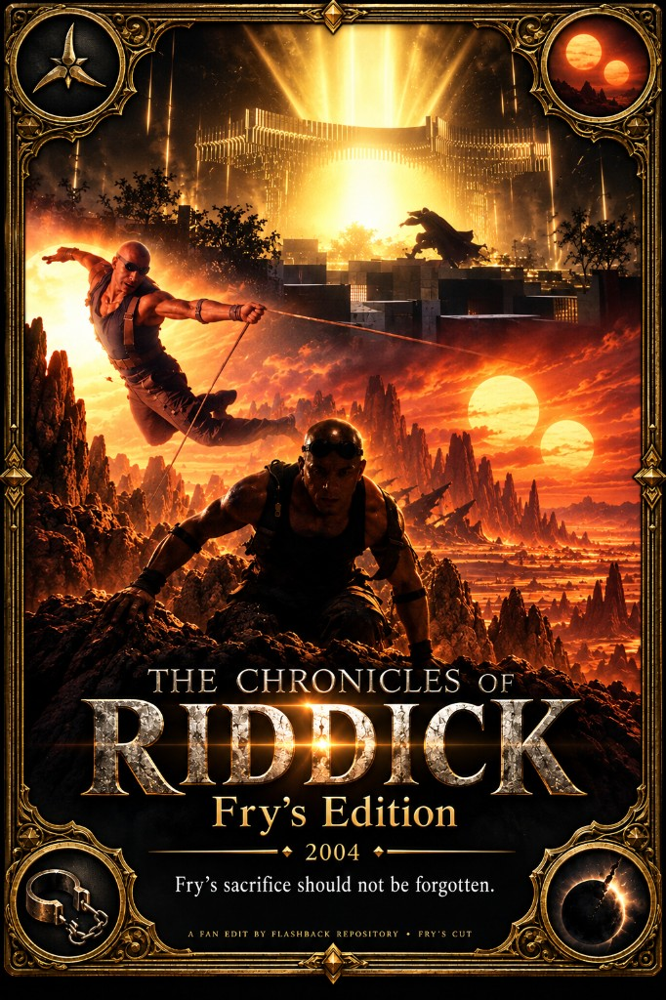

# The Chronicles Of Riddick (2004) — Fry's Edition

A high-def, theatrical-leaning *Chronicles of Riddick* cut in the spirit of **Carolyn Fry** — less extended-cut sleaze, less Dame Vaako ambition theater, less ruined-Jack/Kyra melodrama, more Necromonger war and plot. Slogan: **Fry's sacrifice should not be forgotten.** About **~25 minutes** out of the extended Blu-ray source (**52** picture holes).

## Motivation

Nobody expected a sequel to *Pitch Black* (2000) to work — and a lot of it still does: Helion Prime, the Necromongers, Crematoria, the games and *Dark Fury* orbit. What fails is the character balance *Pitch Black* had. Carolyn Fry, the protagonist of that film, is never mentioned. Jack/Jackie is ruined into Kyra and eventually killed off. A new female lead — Dame Vaako (Thandiwe Newton) — is written and played as an ambitious irritant rather than a person you can stand next to the war story.

The **extended Blu-ray** made it worse: extra sleaze, generic Hollywood prophecy/vision padding, and a longer path through beats that the rare theatrical DVD already paced better. Theatrical never got a proper HD upgrade. This edit starts from the extended HD master, trims toward that theatrical spine (leaving unproblematic extended material), restores theatrical audio where it helps, and further cuts Dame Vaako and Kyra stretches so Vaako reads as a **bystander** and the war can lead.

Imagining how **Carolyn Fry** would have preferred the sequel edited: less sleaze, more plot. Companion cleanup: [Riddick (2013) — Unjinxed](../Riddick%20(2013)%20-%20Unjinxed/).

## Changes

- **Extended-cut sleaze / padding out** — Toombs smash-and-grab chatter, prison-waffle digs, “party poppers,” and similar extended-only junk trimmed toward a theatrical-leaning pace.
- **Dame Vaako reduced to bystander** — loyalty-test / patience rant and the long **Furya seer prophecy** vision block (~source `52:02–53:38`) cut or sharply reduced so she is not the ambitious idiot the extended cut wants.
- **Kyra / Jack melodrama trimmed** — Crematoria convict-code guest stretch, surface-run / rope / hangar padding, and the late **“Are you with me, Kyra?” / “You keep what you kill”** death beat among the larger holes (~`1:11–1:15`, `~1:37–1:39`).
- **Helion / Imam trust digression** shortened (~`7:52–10:16` — New Mecca / “did I make a mistake, Imam?” stretch) so the Necromonger arrival can land sooner.
- Some **theatrical-version audio** restored where useful; unproblematic extended sequences left in.
- Short silent / action holes throughout for pace (full hole list lives with the Kdenlive project on the NAS).

### Still in the cut (intentionally)

- Helion Prime invasion and Necromonger campaign spine.
- Crematoria prison break and the day/night surface run that the plot needs.
- Lord Marshal / “you keep what you kill” franchise mythology where it is not Dame Vaako vision-padding or Kyra soap.

### TODO

- **Next: Jack/Jackie flashback → Carolyn Fry** — replace the Jack/Jackie flashback with Carolyn Fry’s flashback from *Pitch Black* (priority #1 for the next pass).
- **Label remaining TBD holes** in the project `CHANGES.md` (many short silent cuts still unnamed).
- **Spot-check theatrical audio joins** vs. extended picture.
- **Catalog media** — tip still `wip` / empty `media` until master stub is published.

---

Want to contribute a cut or fix notes? See [Submit](/submit).
