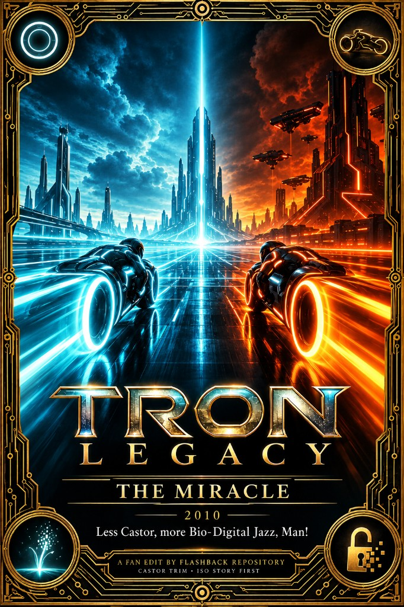

# Tron Legacy (2010) — The Miracle

Slogan: **Less Castor, more Bio-Digital Jazz, Man!**

This is a shorter *Tron: Legacy*. It removes a lot of Castor’s (Zuse’s) nightclub material and other slow padding so the main story is clearer. The Daft Punk music and the big Grid action scenes stay.

## Why “The Miracle”

The title points at the movie’s real message: **artificial intelligence is coming**, and it can remake the world.

It can go in a **utopian** direction — for every person, and maybe every life form on this planet and in this solar system. Or the **exact opposite**: AI used to start wars, tighten control over the smallest parts of our lives, and give us no more agency than we had before it showed up.

*Legacy* puts that choice on screen through Flynn’s ISOs (the “miracle”) and through CLU’s purge. This edit highlights **Jeff Bridges’s AI speech** as the reference point for that idea:

> Disease? History! Science, philosophy! Every idea man has ever had about the universe up for grabs! Bio-digital jazz, man.

## Motivation

A lot of people remember *Tron: Legacy* for the nightclub and for Michael Sheen as Castor. Those scenes are loud and campy, and they make it harder to notice the story above — Flynn’s failed “perfect system,” CLU’s takeover, Quorra as the last ISO, and what that kind of intelligence could mean in the real world.

**Garrett Hedlund** plays Sam Flynn. He also played Patroclus in *Troy* (Achilles’s younger cousin and close companion). He did a strong job in both movies. In *Legacy*, Sam and Quorra (Olivia Wilde) are central to the ending. The third *Tron* movie cut both of them out of the story. All that is left is a quick picture of the two of them — just enough so the audience has “something.” That third movie was a disaster and a real violation of what *Legacy* set up.

*Legacy* itself was a serious, honest try. This edit cuts the worst Castor/nightclub padding and shortens slow stretches between action, so Bridges’s speech and the miracle/ISO story are easier to follow.

## Changes

**About 10.6 minutes removed across 30 cuts.** Full list: [CHANGES.md](CHANGES.md).

### Castor / Zuse (nightclub)
- **Private lounge** (~70s) — he takes them to a private room (“Cozy,” etc.)
- **Deal with Clu + “End of line, man”** (~44s) — Castor’s side deal and betrayal line
- **Toast / disk** (~45s) — “Greetings, programs!” and taking the disk
- Short identity lines kept (“Zuse has been around…”) so the betrayal still makes sense

### Story kept, padding shortened
- CLU’s takeover and the “perfect system” idea stay (some flashback/finale lines shortened, not removed)
- ISO / Purge / “miracle” explanation tightened
- Father/son scenes and Grid action kept; slow connective bits trimmed

### Music
- Daft Punk Grid cues stay; long nightclub stop-and-show bits do not

---

Want to contribute a cut or fix notes? See [Submit](/submit).
