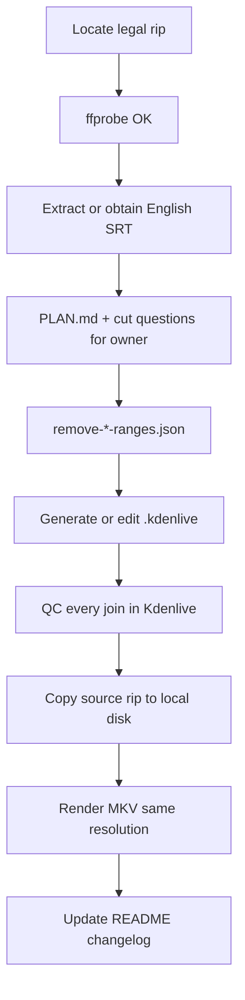

# Fan edit instructions for LLM agents

This document tells an AI assistant how to create, maintain, and render **movie fan edits** in this repository. Read it before touching any FanMix project.

Human overview: [README.md](../README.md).

---

## 1. What you are building

A **FanMix** is a personal re-cut of a film the owner already owns. Goals vary by project:

| Edit style | Typical goal |
|------------|----------------|
| **UnJossed / Unjinxed / DeSchwartzed** | Remove cringe, sexist, or tone-breaking lines and set pieces (often Whedon-style quips, gross-outs, or studio-mandated humor). |
| **Kid friendly** | Remove violence, horror, sexuality, and frightening imagery entirely. |
| **Character / plot trims** | Remove a character or subplot (e.g. Frank Bennett) while keeping the emotional spine. |
| **Pacing / exposition** | Remove redundant narration or “explaining the clues” scenes. |

You are the **director** for editorial calls, but **confirm destructive or ambiguous cuts** with the owner when the story impact is large.

---

## 2. Repository rules (non-negotiable)

1. **No copyrighted media in git** — no `.mkv`, `.mp4`, ripped discs, or download links. Only project files: `.kdenlive`, `.srt`, `.ass`, `.json`, `.md`, `.py`, `.sh`, logs if useful.
2. **Paths in `.kdenlive`** may point at the owner’s local rips (e.g. `/Horror and SciFi/...`). Use paths that match their machine layout; document the expected rip location in the FanMix `README.md`.
3. **Do not commit secrets** or credentials.
4. **Commits** — only when the user explicitly asks.
5. The owner has **legitimate copies** of every source film; do not help locate pirated content.

---

## 3. Folder layout

Create each edit under `FanMixes/`:

```text
FanMixes/
  Serenity (2005) - Unjossed/
    README.md                          # Human summary + how to build/render
    PLAN.md                            # Optional: editorial strategy, QC, filler plan
    Serenity (2005) - Unjossed.kdenlive
    Serenity (2005) - Unjossed.srt     # Source-timeline English subs (working copy)
    Serenity (2005) - Unjossed.kdenlive.ass
    Serenity (2005) - Unjossed.kdenlive.shifted.srt   # After cuts — output timeline
    remove-serenity-ranges.json        # Machine-readable cut windows (seconds)
    generate-serenity.sh               # Optional: regen kdenlive from subs + JSON
    render_final_mkv.py                # Optional: ffmpeg render from playlist2
```

**Naming:** `Title (Year) - Edition Name` — match existing projects (`Alien Resurrection (1997) - UnJossed`, `Riddick (2013) - Unjinxed`).

---

## 4. Tools

Install on Windows (owner machine):

```powershell
powershell -ExecutionPolicy Bypass -File scripts/install-fanedit-render-tools.ps1
```

Requires: **Python 3**, **ffmpeg/ffprobe**, **Kdenlive** (GUI), optionally **Handbrake** for ripping.

**Source readiness gate** — before any pipeline step, verify the rip is complete:

```bash
ffprobe -v error -show_entries format=duration -of default=noprint_wrappers=1:nokey=1 "/path/to/movie.mkv"
```

If this fails with `EBML header parsing failed` or `Invalid data`, the file is still downloading or corrupt. **Stop and wait** until `ffprobe` returns a duration.

---

## 5. End-to-end workflow



### Phase A — Source and subtitles

1. **Find the rip** (owner-provided path). Example: `N:\Videos\Horror and SciFi\Serenity (2005)  [2160p x265 10bit FS90 Joy].mkv`.
2. **Probe** video: resolution, fps, duration, audio layout (stereo vs 5.1), codec (note 10-bit HEVC vs 8-bit for render script).
3. **Subtitles** — prefer English SRT aligned to the **same rip**:
   - Extract: `ffmpeg -i movie.mkv -map 0:s:0 -c:s srt subs.en.srt` (adjust stream index).
   - Or use a sidecar from the release’s `Subs/` folder.
4. Check in a working copy as `Title (Year) - Edition.srt` (or `Movie.en.srt` in the FanMix folder). **Do not commit** if the repo policy gitignores subs from releases; follow `.gitignore`.

### Phase B — Editorial plan

1. Write **`PLAN.md`** for non-trivial edits (see [Fried Green Tomatoes PLAN.md](../FanMixes/Fried%20Green%20Tomatoes%20%281991%29%20-%20No%20Frank%20Bennett/PLAN.md)).
2. Watch or skim with subs; build:
   - **Cringe / tone** list (dialogue to cut or trim).
   - **Gore / shock** list (shorten or remove; kid-friendly = remove entirely).
   - **Reorder** notes (only when flow clearly improves).
3. Present the owner a **numbered question list** for ambiguous removals (see §8).
4. Record **director defaults** in `PLAN.md` when you cut without asking (with one-line rationale).

### Phase C — Cut list (`remove-*-ranges.json`)

Format (seconds on **source** timeline):

```json
{
  "description": "What this file removes and how it was derived",
  "ranges": [
    {"start": 414.85, "end": 424.34, "join_fade": false},
    [120.5, 145.0]
  ]
}
```

- Times are **floating-point seconds** from file start.
- Merge nearby hits (e.g. cues within **90 s**) and pad (**±5–10 s**) so lines breathe; tighten in QC.
- `"join_fade": false` — hard cut at that seam (same room / no time jump).
- Build ranges by:
  - **Keyword/regex** over SRT text (good for dialogue-driven cuts).
  - **Manual timestamps** from playback (required for silent gore or visual-only cringe).
  - **Plot references** (Wikipedia/IMDb) only for *finding* scenes, not for timing.

**Limitation:** Subtitle-only automation **misses** silent shots and **false-positives** on innocent lines in the same cue block. Always QC in Kdenlive.

### Phase D — Kdenlive timeline (scene-per-subtitle-block)

The standard pattern for rearrange/remove edits:

1. **One timeline clip per subtitle cue** (or per merged “scene” block), so deleting a block = deleting a scene.
2. In the `.kdenlive` XML, the render pipeline reads **`playlist id="playlist2"`** — sequential `<entry>` elements with `in` / `out` timecodes pointing at the source chain (`chain0` or `chain1`).
3. **Removed** ranges simply omit entries (gaps are closed on export).
4. **Reordered** scenes: drag blocks in Kdenlive or reorder `<entry>` elements and fix subtitle shift logic.
5. **Join discipline** (from [Silent Hill README](../FanMixes/Silent%20Hill%20%282006%29%20-%20Nay%20Tomorrow/README.md)):
   - Cut on the **switching frame** when possible; leave **handles** (“wings”) for crossfades.
   - Use short **blanks** or **audio/video fades** on large time jumps (see automated `--join-fade-sec` below).
   - **Room tone** or dip-to-black beats a naked hard cut across locations.

**Automated generation** (when `scripts/kdenlive_from_subs.py` is present):

```bash
bash "FanMixes/My Film (1999) - Edition/generate-myfilm.sh" "/path/to/rip.mkv"
```

Typical flags (see [Fried Green Tomatoes generate-no-frank.sh](../FanMixes/Fried%20Green%20Tomatoes%20%281991%29%20-%20No%20Frank%20Bennett/generate-no-frank.sh)):

| Flag | Purpose |
|------|---------|
| `--keep-full-timeline` | Keep full film pacing (not dialog-only compression). |
| `--remove-ranges-json` | Apply cut windows. |
| `--snap` | Expand cuts to GOP/keyframe boundaries (cleaner ffmpeg joins). |
| `--join-fade-sec 0.35` | Dip/fade on big jumps. |
| `--join-fade-min-gap 72` | Only fade if >72 s removed at seam. |

**Outputs:** `.kdenlive`, `.kdenlive.ass`, `.kdenlive.shifted.srt`.

**Manual path** (always valid): Open Kdenlive → import rip → split on subtitle boundaries → delete/disable blocks → save. Reference: [Alien Resurrection (1997) - UnJossed](../FanMixes/Alien%20Resurrection%20%281997%29%20-%20UnJossed/).

### Phase E — Quality control

Before render, check every **join**:

- [ ] No orphaned dialogue (cut mid-conversation without intent).
- [ ] No leftover **banned** visuals after a dialogue cut (extend range).
- [ ] Subtitles still readable (`shifted.srt` / ASS regenerated if timeline changed).
- [ ] Audio pops — add 1–2 frame handles or crossfade.
- [ ] Music/OST edits documented if external audio was added (licensing note in README).

### Phase F — Render

#### Step 0 — Copy source rip from NAS to local disk (required)

The owner’s rips and this repo often live on **NAS** (e.g. `N:\Videos\...`, `\\NobiServ\...`). NAS is **slow and unreliable** for long ffmpeg reads — do **not** render the final MKV directly from a network path.

1. **Copy the source video** (the rip referenced in `.kdenlive` / `README.md`) to a **local** folder before starting pass 1, e.g. `C:\Videos\FanEditRender\` or `%TEMP%\fanedit-source\`.
2. **Verify the local copy** with `ffprobe` (same duration as NAS original). If copy fails or sizes differ, re-copy before rendering.
3. **Render from the local file** — pass `--video` to `render_final_mkv.py` pointing at the local copy, or temporarily update `chain0` `resource` in Kdenlive for a GUI export.
4. **Write the output MKV locally** as well (same scratch folder or `C:\Videos\FanEditRender\out\`). Do **not** encode directly to NAS.
5. **Copy the entire project folder back to the server** after a successful render — **minus the original source rip** (see Step 1 below).

```powershell
# Example: copy rip to local scratch, then render from local path
$src = "N:\Videos\Horror and SciFi\Serenity (2005)  [2160p x265 10bit FS90 Joy].mkv"
$localDir = "C:\Videos\FanEditRender"
$local = Join-Path $localDir (Split-Path $src -Leaf)
New-Item -ItemType Directory -Force -Path $localDir | Out-Null
Copy-Item -LiteralPath $src -Destination $local -Force

ffprobe -v error -show_entries format=duration -of default=noprint_wrappers=1:nokey=1 $local

python render_final_mkv.py --video $local --out (Join-Path $localDir "Serenity (2005) - Unjossed - final.mkv")
```

For multi-hour rips, `robocopy` with `/Z` (restartable) is fine instead of `Copy-Item` if a copy was interrupted.

Kdenlive **preview/QC** may still use NAS paths; only the **final long encode** must use local media.

#### Step 1 — Sync project folder back to server (required after render)

When you copied the FanMix folder and source rip to local scratch for rendering, **push the whole project folder back to NAS** once the encode succeeds. The source rip already lives in the owner’s library (e.g. `N:\Videos\Horror and SciFi\...`) — **do not** copy that file back into the repo or re-upload it.

**Include on sync:** final `.mkv`, `.kdenlive`, shifted subs, cut JSON, scripts, logs, `README.md`, `PLAN.md`.

**Exclude:** the original source rip MKV (and any other full-length library rips you pulled down only for encoding).

```powershell
# Windows — sync local project folder back to NAS, skip source rip
$proj     = "FanMixes\Serenity (2005) - Unjossed"
$local    = "C:\Videos\FanEditRender\Serenity (2005) - Unjossed"
$nas      = "N:\Videos\FanEdits\$proj"
$srcName  = "Serenity (2005)  [2160p x265 10bit FS90 Joy].mkv"
robocopy $local $nas /E /XF $srcName /Z /J
```

```bash
# Linux — rsync project folder back to SMB/NAS, skip source rip
SRC_NAME='Serenity (2005)  [2160p x265 10bit FS90 Joy].mkv'
rsync -av --exclude="$SRC_NAME" \
  ~/FanEditRender/Serenity\ \(2005\)\ -\ Unjossed/ \
  "/mnt/nas/Videos/FanEdits/FanMixes/Serenity (2005) - Unjossed/"
```

If you only rendered locally (project still on NAS, source copied to scratch), copy **at minimum** the final `.mkv`, updated `render_final_mkv.log`, and any changed project files — still **never** the library source rip.

**Option 1 — ffmpeg two-pass (preferred for long HEVC exports)**

Copy/adapt [render_final_mkv.py](../FanMixes/Fried%20Green%20Tomatoes%20%281991%29%20-%20No%20Frank%20Bennett/render_final_mkv.py):

- Parses **`playlist2`** `chain0` segments.
- Builds `trim` + `concat` filter graph.
- **Video:** `libx265` two-pass, target bitrate ≈ source format average minus audio overhead.
- **Audio:** AAC 5.1 @ 224 kb/s (adjust if source is stereo-only).
- **Subs:** mux `*.kdenlive.shifted.srt` as default English track.
- Match **resolution and fps** to source (`ffprobe` stream fields); use `yuv420p` or `yuv420p10le` to match source bit depth.

**Option 2 — Kdenlive GUI render**

Acceptable for shorter films or trial exports; use same resolution preset as source.

**Expectations:** Full 4K HEVC two-pass can take **many hours** on CPU. Log to `render_final_mkv.log`.

---

## 6. Kdenlive XML essentials

| Element | Role |
|---------|------|
| `chain0` / `chain1` | Source file `resource` path and clip length. |
| `playlist2` | **Master edit timeline** — list of kept `in`/`out` segments. |
| `producer` / `tractor` | Kdenlive UI tracks; don’t break IDs casually. |
| `.kdenlive.ass` | Subtitles for preview in editor. |
| `.kdenlive.shifted.srt` | Subs on **output** timeline (for final mux). |

**Path style:** Projects often use roots like `/Horror and SciFi/...` (Kdenlive media root). Match the owner’s existing projects.

---

## 7. Director guidelines

Apply consistently unless the FanMix `PLAN.md` says otherwise:

1. **Protect the emotional spine** — remove noise, not payoff.
2. **Cringe** — cut quips that undercut tension, especially after horror or before climax; prefer trimming a line over deleting a whole scene when possible.
3. **Gore / shock** — shorten beats or cut entirely; for “soft UnJossed” edits, reduce rather than eliminate unless owner wants kid-friendly.
4. **Pacing** — trim establishing repeats, redundant exposition, studio-mandated comic relief.
5. **Reorder** — rare; only when geography/time is clearer (e.g. intercut two threads). Document in README.
6. **Do not** add plot-changing fan fiction without owner approval.
7. **Replacement footage** — only PD/CC0/owned stock; track license in `PLAN.md` (see Fried Green Tomatoes §4).

---

## 8. Questions to ask the owner

Use a numbered list with **timecodes** (from SRT or hh:mm:ss) and **one-line description**. Example template:

```markdown
## Removal confirmations — Serenity (2005) Unjossed

1. **00:42:10** — Kaylee/Jayne “nethers / batteries” exchange: remove entire exchange or only Jayne’s second line?
2. **01:05:xx** — Haven aftermath (bodies on posts): remove entirely, or shorten to reaction shots only?
3. **01:18:xx** — Maidenhead bar fight: keep fight but trim gore, or cut set piece entirely?
...
```

Also ask:

- Target audience (friends / family / kids)?
- **Maximum runtime** change allowed?
- Keep **theatrical** vs extended scenes?
- Any lines/scenes **sacred** (never cut)?

---

## 9. Per-project README template

```markdown
# Title (Year) — Edition Name

## Changes
Bullet list of what this cut does.

## Source media (not in git)
Where the owner should place the rip; exact filename example.

## Build
How to run generate-*.sh / manual Kdenlive steps.

## Render
Copy source rip from NAS to local disk first (see docs/LLM-FAN-EDIT-INSTRUCTIONS.md §5 Phase F).
Command for render_final_mkv.py `--video` (local path) or Kdenlive export settings.

## Sync back to server
After render, copy the **entire project folder** to NAS — **exclude** the original source rip MKV (see §5 Phase F Step 1).

## Changelog
Date — what changed.
```

---

## 10. Reference projects

| Project | Learn this |
|---------|------------|
| [Alien Resurrection (1997) - UnJossed](../FanMixes/Alien%20Resurrection%20%281997%29%20-%20UnJossed/) | UnJossed tone; `.kdenlive` + `.srt` + `.ass`; gross-out removal. |
| [Riddick (2013) - Unjinxed](../FanMixes/Riddick%20%282013%29%20-%20Unjinxed/) | Dialog-focused cringe removal. |
| [Fried Green Tomatoes (1991) - No Frank Bennett](../FanMixes/Fried%20Green%20Tomatoes%20%281991%29%20-%20No%20Frank%20Bennett/) | `remove-*-ranges.json`, `generate-*.sh`, `render_final_mkv.py`, `PLAN.md`. |
| [Silent Hill (2006) - Nay Tomorrow](../FanMixes/Silent%20Hill%20%282006%29%20-%20Nay%20Tomorrow/) | Gore + exposition; join discipline; external OST notes. |
| [Thor Ragnarok (2017) - Kid friendly](../FanMixes/Thor%20Ragnarok%20%282017%29%20-%20Kid%20friendly/) | Kid-friendly severity. |

---

## 11. Checklist before marking a FanMix “done”

- [ ] `ffprobe` passes on source rip.
- [ ] `README.md` complete (changes, source path, build, render).
- [ ] Cut list JSON + rationale documented.
- [ ] `.kdenlive` opens with correct media path.
- [ ] All joins QC’d; shifted subs match output.
- [ ] Source rip **copied to local disk**; final render read from local copy (not NAS).
- [ ] Final `.mkv` at **same resolution** as source, high-quality HEVC, embedded English subs.
- [ ] Project folder **synced back to server** (final MKV, project files, logs) — **excluding** the original source rip.
- [ ] Root [README.md](../README.md) Fan Edit list updated (if owner wants release).

---

## 12. Common failures

| Symptom | Fix |
|---------|-----|
| `EBML header parsing failed` | Rip incomplete, bad NAS read, or incomplete local copy — wait/re-copy; confirm size and `ffprobe` duration match NAS original. |
| `playlist2 not found` | Wrong kdenlive structure; regenerate or fix XML. |
| `missing shifted subs` | Re-run `kdenlive_from_subs.py` or export subs after edit. |
| Audio glitch at cut | Extend handles; keyframe snap; short crossfade. |
| Subtitle drift | Regenerate shifted SRT/ASS from source SRT + kept segments. |
| Render stalls, I/O errors, corrupt output | Source or output on NAS — **copy rip locally**, re-render; verify with `ffprobe` before and after. |

---

*Internal doc for LLM agents working in the FanEdits repository.*
